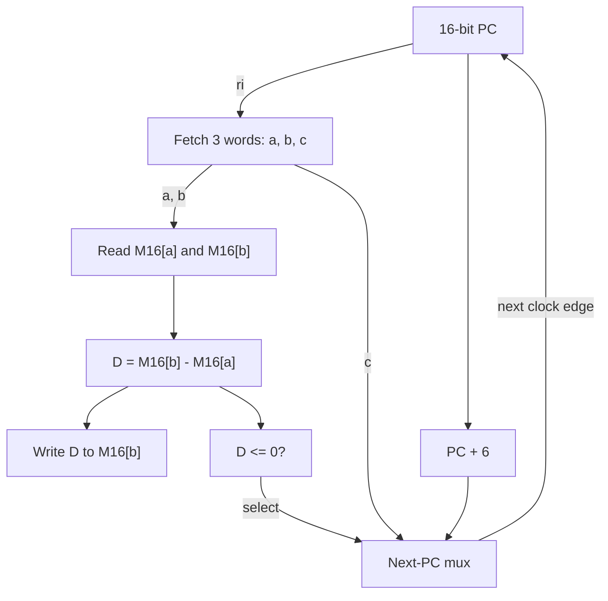

# ELEC3441 Homework 1: Reference Answers

## A.1.1 Iron Law: Average CPI

Average CPI = sum of (instruction count × class CPI) / total instruction count.

| Program | Instructions | Cycles on A | CPI on A | Cycles on B | CPI on B |
| --- | --- | --- | --- | --- | --- |
| P | 1,800,000 | 12,200,000 | 6.7778 | 13,000,000 | 7.2222 |
| Q | 875,000 | 4,000,000 | 4.5714 | 7,000,000 | 8.0000 |
| R | 6,000 | 53,000 | 8.8333 | 85,000 | 14.1667 |

Use an instruction-count-weighted average, not the unweighted mean of the three class CPIs. Retain exact totals for subsequent execution-time calculations.

## A.1.2 Iron Law: Execution Time and Speedup

Execution time = total cycles / clock frequency. A runs at 1.5 GHz; B runs at 1.2 GHz. Speedup of A over B = time on B / time on A.

| Program | Time on A (ms) | Time on B (ms) | Speedup of A over B |
| --- | --- | --- | --- |
| P | 8.133333 | 10.833333 | 1.332× |
| Q | 2.666667 | 5.833333 | 2.188× |
| R | 0.035333 | 0.070833 | 2.005× |

Processor A is faster for all three programs. Its execution time is lower because it requires fewer cycles and has a higher clock frequency.

## A.1.3 Iron Law: Geometric Mean of Speedups

GM = [(325/244) × (35/16) × (425/212)]^(1/3) = 1.80094 ≈ 1.801.

Processor A has a geometric-mean speedup of approximately 1.80× over B across P, Q and R. The geometric mean gives each program equal weight in the speedup ratios; it is not the ratio of total runtimes.

## A.1.4 Iron Law: Maximum Speedup Using Total Runtime

Improve Branch/Jump instructions on the slower processor B. Across one execution each of P, Q and R, B spends:

| Class | Total instructions | Class CPI | Total cycles |
| --- | --- | --- | --- |
| ALU | 1,501,000 | 1 | 1,501,000 |
| Branch/Jump | 553,000 | 20 | 11,060,000 |
| Load/Store | 627,000 | 12 | 7,524,000 |

Branch/Jump accounts for the most cycles. In the ideal limit where those instructions take zero time, with the clock frequency and other costs unchanged:

Maximum speedup = 20,085,000 / (1,501,000 + 7,524,000) = 2.22548 ≈ 2.23× relative to original B.

This is the Amdahl's-law upper bound. For comparison, eliminating all ALU cost yields at most 1.08077× and eliminating all Load/Store cost yields at most 1.59900×.

## A.1.5 Iron Law: Choosing a Class Using Geometric Mean

The choice remains Branch/Jump. Under the same ideal assumption that the selected class becomes infinitely fast, compare improved B with original B:

| Class improved | Speedup for P | Speedup for Q | Speedup for R | Geometric mean |
| --- | --- | --- | --- | --- |
| ALU | 1.0833 | 1.0769 | 1.0119 | 1.0569× |
| Branch/Jump | 1.8571 | 3.5000 | 3.4000 | 2.8063× |
| Load/Store | 1.8571 | 1.2727 | 1.3934 | 1.4878× |

For Branch/Jump, GM = [(13/7) × (7/2) × (17/5)]^(1/3) = 2.80628 ≈ 2.81×.

Thus Branch/Jump is best under both metrics for these programs. Its maximum speedup is 2.23× by total runtime and 2.81× by geometric mean, both relative to original B. This agreement is specific to the data; the metrics weight programs differently and need not select the same class in general. Comparing improved B against fixed A instead rescales all three geometric-mean scores by the same factor and leaves their ranking unchanged.

## A.2.1 Benchmark Performance: P1–P3

Normalized time for processor X on benchmark i = T(X,i) / T(A,i). These are time ratios, so lower is better; they are not speedup ratios.

| Metric | A | B | C |
| --- | --- | --- | --- |
| Arithmetic mean of raw time (s) | 46,666.67 | 46,666.67 | 46,666.67 |
| Geometric mean of raw time (s) | 40,000 | 40,000 | 40,000 |
| Arithmetic mean of normalized time | 1 | 1.4167 | 1.6667 |
| Geometric mean of normalized time | 1 | 1 | 1 |
| Total raw time (s) | 140,000 | 140,000 | 140,000 |
| Total normalized time | 3 | 4.25 | 5 |

Example for B: normalized times are (2, 0.25, 2), their arithmetic mean is 4.25/3 = 17/12, and their geometric mean is (2 × 0.25 × 2)^(1/3) = 1.

## A.2.2 Benchmark Performance: Interpreting P1–P3

Winning one benchmark each does not by itself establish equal performance; the sizes of the time differences matter.

- Metrics (i), (ii), (iv) and (v), raw arithmetic mean, raw geometric mean, normalized geometric mean and raw total, give a tie.
- Metrics (iii) and (vi), normalized arithmetic mean and normalized total, rank A first, B second and C third when A is the reference.
- Use the geometric mean of normalized times for an equally weighted comparison of benchmark time ratios. Its relative ranking does not depend on the reference processor. Here all three tie.
- For the concrete workload of running P1, P2 and P3 once each, use total raw time. All three also tie at 140,000 seconds. This answers a different question from averaging benchmark ratios.

Why avoid arithmetic averaging of normalized times for a reference-independent comparison? Changing the reference from A to B changes the normalized arithmetic means from (1,17/12,5/3) to (5/3,1,17/12) for (A,B,C), reversing the ranking to B,C,A without changing any runtime. All normalized geometric means remain 1 in this dataset. In general, changing the reference multiplies all geometric-mean scores by one common factor, preserving their ratios and ranking.

## A.2.3 Benchmark Performance: Add P4

Use P1–P4. P4 times for A/B/C are 1,200/2,400/600 seconds.

| Metric | A | B | C |
| --- | --- | --- | --- |
| Arithmetic mean of raw time (s) | 35,300 | 35,600 | 35,150 |
| Geometric mean of raw time (s) | 16,647.17 | 19,796.93 | 13,998.54 |
| Arithmetic mean of normalized time | 1 | 1.5625 | 1.3750 |
| Geometric mean of normalized time | 1 | 1.1892 | 0.8409 |
| Total raw time (s) | 141,200 | 142,400 | 140,600 |
| Total normalized time | 4 | 6.25 | 5.50 |

Metrics (i), (ii), (iv) and (v) rank C first, A second and B third. Thus C is best both for one execution of each program and for equally weighted relative performance.

Metrics (iii) and (vi) instead rank A first, C second and B third. One can favor A under those A-normalized arithmetic metrics, but this is reference-dependent. A's normalized time is always 1 by definition; that is not evidence that its raw performance is uniformly strong. These metrics represent weighting each raw time by the reciprocal of A's time on the corresponding benchmark, rather than the one-run-each workload.

Equal benchmark win counts alone are insufficient, but the actual raw totals and geometric means here support C. For example, C's normalized GM is (4 × 0.5 × 0.5 × 0.5)^(1/4) = 0.840896.

## A.2.4 Benchmark Performance: Replace P4 with P5

Use P1, P2, P3 and P5 only. P5 times are 10,000 times the corresponding P4 times.

| Metric | A | B | C |
| --- | --- | --- | --- |
| Arithmetic mean of raw time (s) | 3,035,000 | 6,035,000 | 1,535,000 |
| Geometric mean of raw time (s) | 166,471.66 | 197,969.28 | 139,985.42 |
| Arithmetic mean of normalized time | 1 | 1.5625 | 1.3750 |
| Geometric mean of normalized time | 1 | 1.1892 | 0.8409 |
| Total raw time (s) | 12,140,000 | 24,140,000 | 6,140,000 |
| Total normalized time | 4 | 6.25 | 5.50 |

All rankings remain unchanged: metrics (i),(ii),(iv),(v) favor C, then A, then B; metrics (iii),(vi) favor A, then C, then B with A as reference.

All normalized metrics are unchanged because the common 10,000 factor cancels in each P5 time ratio. Each raw geometric mean increases by 10000^(1/4) = 10, preserving relative scores. Raw totals and arithmetic means are now dominated by P5, making C's total-runtime advantage much larger. This is appropriate if the intended workload actually includes one full execution of P5; equally weighted benchmark ratios answer a different question.

## A.2.5 Benchmark Performance: General Condition for B to Win

Use the geometric mean of A-normalized times across P1–P6, including both P4 and P5. Assume positive P6 runtimes t_A, t_B and t_C.

The products of normalized times for P1–P5 are 1 for A, 4 for B and 1/4 for C. Including P6 gives:

- G_A = 1.
- G_B = (4t_B/t_A)^(1/6).
- G_C = (t_C/(4t_A))^(1/6).

Lower is better. Since the sixth root is increasing, B beats A when t_B < t_A/4 and beats C when t_B < t_C/16.

**Concise answer:** Using the geometric mean of normalized times, B is uniquely fastest when t_B < min(t_A/4, t_C/16). Equality with the minimum gives a tie for best. Equivalently, P6 must run on B in less than one-quarter of A's time and less than one-sixteenth of C's time.

For example, if t_A=t_C=100 seconds, B is uniquely fastest whenever t_B < 6.25 seconds. For instance, t_B=1 second works.

## A.3.1 RISC-V Arithmetic and Logic

Register mapping: unsigned x → a0, y → a1, z → a2; a3 holds the base address of unsigned a[16]. Assume RV32 and 32-bit unsigned elements. Each item is a separate translation; temporary registers may be overwritten.

### (i) z = z + (x - (y << 1))

```asm
slli t0, a1, 1       # t0 = y << 1
sub  t0, a0, t0      # t0 = x - (y << 1)
add  a2, a2, t0      # z = z + t0
```

x and y remain unchanged. The operations wrap modulo 2^32, matching 32-bit unsigned arithmetic. Example: x=10, y=3, z=5 gives z=9.

### (ii) y = x + 0x757

```asm
addi a1, a0, 0x757
```

0x757 = 1879 fits the signed 12-bit immediate range [-2048, 2047].

### (iii) y = x + 0x7800A757

```asm
lui  t0, 0x7800A
addi t0, t0, 0x757
add  a1, a0, t0
```

LUI constructs 0x7800A000; adding 0x757 completes the constant. The positive low part fits ADDI without an upper-part adjustment.

### (iv) a[3] = a[2] + 1

```asm
lw   t0, 8(a3)
addi t0, t0, 1
sw   t0, 12(a3)
```

Each unsigned element occupies four bytes, so a[2] and a[3] are at byte offsets 8 and 12.

### (v) a[x & 0xF] = y % 16

```asm
andi t0, a0, 0xF
slli t0, t0, 2
add  t0, a3, t0
andi t1, a1, 0xF
sw   t1, 0(t0)
```

The masked index is 0–15; shifting it left by two converts it to a byte offset. For unsigned y, y % 16 equals y & 0xF.

### (vi) z = 4*y + 2*x

```asm
slli t0, a1, 2
slli t1, a0, 1
add  a2, t0, t1
```

Shifts implement multiplication by four and two with unsigned 32-bit wraparound.

## A.3.2 RISC-V Branches and Jumps

Use unsigned branches because x, y and z are unsigned. Register mapping remains x=a0, y=a1, z=a2 and array base=a3. Each item is a separate translation. End labels identify the continuation of the surrounding program; no extra nop is required.

### (i) if (x > y) z = x - y; else z = y - x;

```asm
    bgeu a1, a0, else1
    sub  a2, a0, a1
    j    done1
else1:
    sub  a2, a1, a0
done1:
```

Branch to else when y >= x. Equality correctly produces zero.

### (ii) if (x < y && x > z) x += a[x]; then x += y + z;

```asm
    bgeu a0, a1, after_if2
    bgeu a2, a0, after_if2
    slli t0, a0, 2
    add  t0, a3, t0
    lw   t1, 0(t0)
    add  a0, a0, t1
after_if2:
    add  a0, a0, a1
    add  a0, a0, a2
```

Skip the conditional body if either x >= y or z >= x. The final x+y+z addition always executes and uses the updated x if the body ran. As in the C source, a[x] must be a valid element: x < 16 is required whenever both conditions are true. No index masking is added, since that would change the program.

### (iii) for (x = 0; x < 10; x++) a[x] = x;

```asm
    addi a0, zero, 0
    addi t0, zero, 10
for3:
    bgeu a0, t0, done3
    slli t1, a0, 2
    add  t1, a3, t1
    sw   a0, 0(t1)
    addi a0, a0, 1
    j    for3
done3:
```

Writes a[0] through a[9] with 0 through 9. Final x=10; y and z are unchanged.

### (iv) x=0; while (x <= 10) { a[x]=y; y++; x++; }

```asm
    addi a0, zero, 0
    addi t0, zero, 10
while4:
    bltu t0, a0, done4
    slli t1, a0, 2
    add  t1, a3, t1
    sw   a1, 0(t1)
    addi a1, a1, 1
    addi a0, a0, 1
    j    while4
done4:
```

Exit when 10 < x, so the loop runs 11 times. Writes a[0] through a[10]; final x=11 and y=original y+11 modulo 2^32. z is unchanged.

## A.4.1 Fibonacci Numbers: Array Implementation

Assume 2 <= n <= 46 as stated. Input n is in a0; a1 points to F[100]. Fill F[0] through F[n] and return F[n] in a0.

```asm
fib_array:
    sw    zero, 0(a1)          # F[0] = 0
    addi  t0, zero, 1
    sw    t0, 4(a1)            # F[1] = 1
    addi  t0, zero, 2          # i = 2
    addi  t4, a1, 8            # t4 = &F[i]
fib_array_loop:
    lw    t1, -4(t4)           # F[i-1]
    lw    t2, -8(t4)           # F[i-2]
    add   t3, t1, t2
    sw    t3, 0(t4)            # F[i] = F[i-1] + F[i-2]
    addi  t4, t4, 4            # next array element
    addi  t0, t0, 1            # i++
    bge   a0, t0, fib_array_loop # repeat while i <= n
    addi  a0, t3, 0            # return F[n]
    jalr  zero, 0(ra)
```

The loop runs for i=2 through n, inclusive. It stores the complete required prefix, rather than only computing the final value. It is a leaf function using only caller-saved temporaries, so no stack frame is needed; a1 and saved registers remain unchanged.

## A.4.2 Fibonacci Numbers: Recursive Implementation

Input n=a0, with 0<=n<=46; return F(n) in a0. Use a 16-byte stack frame to preserve ra, s0 and s1.

```asm
fib:
    addi sp, sp, -16
    sw   ra, 12(sp)
    sw   s0, 8(sp)
    sw   s1, 4(sp)

    addi s0, a0, 0          # preserve original n
    addi t0, zero, 2
    blt  a0, t0, fib_return # n<2: a0 already holds n

    addi a0, s0, -1
    jal  ra, fib            # fib(n-1)
    addi s1, a0, 0          # preserve first result

    addi a0, s0, -2
    jal  ra, fib            # fib(n-2)
    add  a0, s1, a0         # return sum

fib_return:
    lw   ra, 12(sp)
    lw   s0, 8(sp)
    lw   s1, 4(sp)
    addi sp, sp, 16
    jalr zero, 0(ra)
```

ra must be saved because each jal replaces it. s0 retains the original n across calls; s1 retains fib(n-1) while fib(n-2) is computed. Each invocation saves and restores the caller's s0/s1, so recursive calls preserve these values. The base case uses the same restoration path. A 16-byte frame maintains stack alignment; one four-byte slot is unused.

## A.5.1 One Instruction Set Computer: Iron Law Comparison

SUBLEQ a,b,c means memory[b] = memory[b] - memory[a], followed by a jump to c if the updated value is <=0. All three operands are addresses.

Assumptions: compare the same program and similar implementation/memory technology. Interpret non-pipelined as the single-cycle RISC-V design taught in class. For a single-cycle SUBLEQ design, assume enough memory ports and combinational reads that instruction fetch and subsequent operand reads can complete within one sufficiently long cycle. For pipelined comparisons, assume similar pipeline sophistication and branch handling; no measured CPI or timing is claimed.

| Iron Law term | Comparison |
| --- | --- |
| Instructions per program | SUBLEQ usually needs more instructions, because many operations supported directly by RISC-V require sequences of subtraction/branch operations. This is workload-dependent, not a claim about every program. |
| Cycles per instruction | Both ideal single-cycle designs have CPI=1. Both pipelines ideally approach CPI=1, but SUBLEQ's two data reads, one data write and conditional branch per instruction create frequent opportunities for memory dependencies, port contention and control hazards. These can increase stalls/flushes. With insufficient memory ports, accesses must instead take extra cycles or stall; enough ports remove contention, not access latency. |
| Cycle time | A single opcode simplifies decoding, but does not guarantee a shorter clock period. SUBLEQ must fetch its instruction, read memory operands, subtract and resolve the next PC; dependent memory accesses can dominate the single-cycle critical path. Pipeline clock period depends on stage partitioning and memory delays. Either design requires actual timing analysis for a quantitative comparison. |

**Conclusion:** SUBLEQ trades instruction-set simplicity for usually more instructions and heavy memory/control activity. It is likely slower for many general-purpose workloads under these assumptions, but exact speedup or a universally shorter SUBLEQ cycle time cannot be inferred from the ISA alone.

## A.5.2 SUBLEQ Single-Cycle Datapath

Assume combinational memory reads and writes on the active clock edge. Treat data as signed 16-bit two's-complement values and assume subtraction does not overflow, so the sign-bit test implements the stated mathematical comparison. Use aligned word/instruction addresses.

One instruction has three 16-bit address words (a,b,c), occupying six bytes. The 16-bit PC addresses the instruction read port ri, which returns all three words (48 bits). The sequential next PC is PC+6, not PC+3 or PC+4.

| Connection | Function |
| --- | --- |
| ri address = PC | Fetch a=M16[PC], b=M16[PC+2], c=M16[PC+4]. |
| ra address = a; rb address = b | Read two 16-bit operands A=M16[a], B=M16[b]. |
| 16-bit subtractor | Compute D=B-A. |
| Write address = b; write data = D; write enable = 1 | Always store D at b, regardless of the branch decision. |
| Signed non-positive detector | take_branch = D[15] OR (D==0). |
| 16-bit adder and 2:1 next-PC multiplexer | nextPC = take_branch ? c : PC+6. |



Fetch, operand reads and write are ports of the same specified memory. The write address b also comes from the fetched instruction. During the cycle, instruction fetch feeds the operand addresses; the subtraction drives write data and branch selection. At the active edge, memory[b] and PC update together. This requires a long enough clock period for both dependent read stages and subsequent logic. Multiple ports alone do not guarantee combinational read timing.

Hardware: one 16-bit PC register, the specified memory, a 48-to-three-16-bit field split, one 16-bit subtractor, a sign/zero detector, a 16-bit +6 adder and a 16-bit 2:1 mux. No general-purpose register file or opcode decoder is needed. Addresses are 16 bits; a design allowing address overflow wraps modulo 2^16.

## A.5.3 Implement SUBLEQ with RV32I

a0, a1 and a2 hold aligned host byte addresses a, b and c. Operands in memory are signed 16-bit values; assume their mathematical difference fits signed 16 bits, as stated in the question.

```asm
    lh   t0, 0(a0)       # signed memory[a]
    lh   t1, 0(a1)       # signed memory[b]
    sub  t2, t1, t0      # result = memory[b] - memory[a]
    sh   t2, 0(a1)       # always store the 16-bit result
    blt  zero, t2, next  # positive result: fall through
    jalr zero, 0(a2)     # zero or negative: jump to c
next:
    # following code
```

LH sign-extends a 16-bit operand to 32 bits; SH writes exactly 16 bits. BLT is a signed comparison. JALR with destination zero transfers control without overwriting ra. The store happens for both branch outcomes. The aligned c assumption ensures JALR reaches the intended address.

## Part B. Single-cycle RISC-V processor

The following is one working design. Selector encodings describe this circuit; other encodings work if the decoder and multiplexers agree.

### Stage 1: ADDI (rv32_addi.circ)

Keep the existing ADD, SUB, AND and OR register paths. For ADDI (opcode 0x13, funct3=0), sign-extend instruction bits [31:20], select this immediate as ALU operand 2, add it to rs1, and write the result to rd. The PC advances by 4. In the supplied ADDI test, x1 through x5 finish at 1, 2, 3, 2 and 0xffffffff respectively.

### Stage 2: AUIPC, LW and SW (rv32_isu.circ)

| Instruction | Computation | Destination |
| --- | --- | --- |
| AUIPC | Current PC + (instruction[31:12] followed by 12 zero bits) | rd |
| LW | Address = rs1 + sign-extended I immediate | Load the 32-bit word from that address into rd |
| SW | Address = rs1 + sign-extended S immediate | Store rs2 at that address; no register write |

For SW, concatenate instruction[31:25] and instruction[11:7] before sign extension. For both LW and SW, the ALU calculates a **byte address**; the word-addressed Logisim RAM uses address bits [15:2]. In the supplied LW test, reset first, then load the image into both instruction and data memory. Expected: x1=0xa00, x2=0xdeadbeef, x3=0xfacecafe.

### Stage 3: Branches and jumps (rv32_all.circ)

| Instruction | Next PC | Register write |
| --- | --- | --- |
| BEQ / BNE | PC + B offset if rs1 equals / differs from rs2; otherwise PC + 4 | None |
| BLT / BGE | PC + B offset if signed rs1 is less than / greater than or equal to signed rs2; otherwise PC + 4 | None |
| JAL | PC + J offset | rd = old PC + 4 |
| JALR | (old rs1 + sign-extended I immediate) & 0xfffffffe | rd = old PC + 4 |

Build the B offset by concatenating instruction bits [31], [7], [30:25], [11:8], then a zero bit. For the J offset use [31], [19:12], [20], [30:21], then a zero bit. Sign-extend each result to 32 bits. The low zero is already included: add the offset directly to the address of the branch or jump.

BGE can use the inverse of the signed less-than comparison; equality therefore takes BGE. For JALR with rd=rs1, the target uses the register value before writeback. Writes to x0 are discarded.

### Control table for the completed design

| Instruction | ALU input 2 | ALU operation | Write to rd | Read RAM | Write RAM | Next PC |
| --- | --- | --- | --- | --- | --- | --- |
| ADD / SUB / AND / OR | rs2 | As named | ALU result | No | No | PC + 4 |
| ADDI | I immediate | Add | ALU result | No | No | PC + 4 |
| AUIPC | Unused | Unused | PC + U immediate | No | No | PC + 4 |
| LW | I immediate | Add | RAM data | Yes | No | PC + 4 |
| SW | S immediate | Add | None | No | Yes | PC + 4 |
| BEQ / BNE / BLT / BGE | Unused | Separate comparator | None | No | No | Branch target if taken; else PC + 4 |
| JAL / JALR | Unused | Separate target adder | PC + 4 | No | No | Jump target |

One way to check the final stage is the supplied combined JAL/JALR test. Its byte PC sequence is 0x00, 0x04, 0x08, 0x2c, 0x30, 0x18, 0x1c. At the final EBREAK, halt=1, x1=x2=0x0c and x4=x5=0x34. LUI and SLLI are optional extensions.
